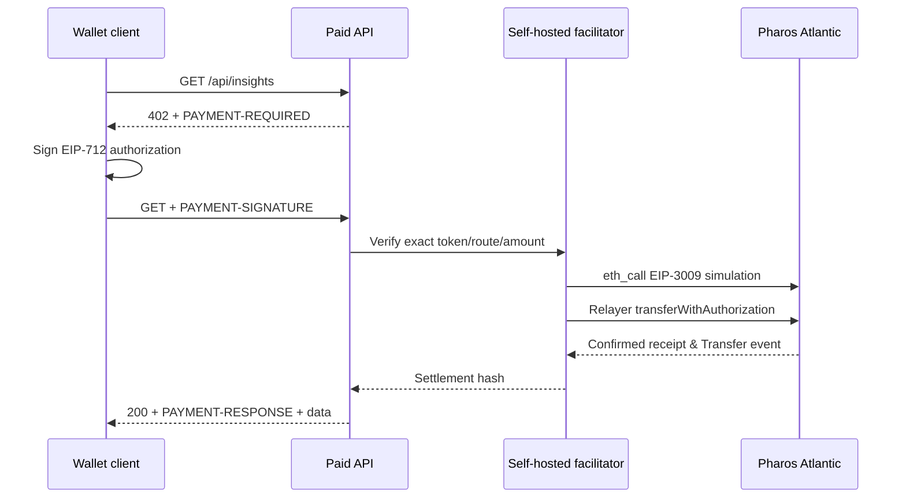

# x402 Paywalled API — Pharos Agent Arena

**Challenge:** Medium / Payments · **100 points** (+50 optional video)  
**Network:** Pharos Atlantic Testnet, chain ID **688689**, CAIP-2 `eip155:688689`  
**Public demo / Proof Link (after deployment):** https://x402-paywalled-api.trantanlong2411.workers.dev/  
**Source:** https://github.com/trantanlong2411-droid/x402-Paywalled-API

This is a self-hosted x402 v2 paid API with a wallet-signing client and a facilitator that validates and settles **real testnet USDC authorizations**. The site never pretends a payment is complete: paid data requires a successful on-chain receipt and a PAYMENT-RESPONSE transaction hash.

## Challenge requirements

| Rubric | Implementation |
| --- | --- |
| 1. Atlantic Testnet + test USDC | Fixed network `eip155:688689` and actual deployed 6-decimal Atlantic USDC `0xcfC8330f4BCAB529c625D12781b1C19466A9Fc8B`, which passed live `authorizationState` support checks. EIP-712 domain name/version must match the contract. |
| 2. Two paid, one free | Free `GET /health`; paid `GET /api/insights` for **0.001 test USDC**, `GET /api/report` for **0.003 test USDC**. No-payment requests receive 402 and PAYMENT-REQUIRED. |
| 3. Own facilitator | `GET /supported`, `POST /verify`, `POST /settle` (also `/facilitator/*`). On-chain signature/state/balance/simulation validation, test PHRS gas-paid settlement, and persisted authorization locks. |
| 4. 402 → EIP-712 signed payment → 200 | Wallet UI and CLI client sign a testnet EIP-3009 authorization; relayer sends transaction, checks actual success receipt and Transfer event; only then returns paid data + PAYMENT-RESPONSE with real Atlantic explorer hash. **Requires configured facilitator/testnet balances; not claimed complete without a real tx.** |
| 5. Reject bad/underpaid | Invalid/expired signatures, wrong recipient/network, underpayment, spent nonce, balance failure, failed simulation and reused authorizations are rejected; paid route returns a fresh 402. |
| 6. No hardcoded keys | Facilitator key is an encrypted Cloudflare Worker secret; client key is set locally as environment variable; browser signs through an EVM wallet. `.dev.vars` / `.env` / key files are gitignored. |

## Live protocol



**Real wallet / testnet funds are required to prove the signed on-chain step.** No transaction hash is manufactured in CI. The Durable Object ledger reserves the authorization before broadcast to prevent replay; ambiguous settlement outcomes remain reserved instead of being resent blindly.

### Token discovery

The first candidate, `0xE0BE08c77f415F577A1B3A9aD7a1Df1479564ec8`, was **not** EIP-3009-compatible in our live audit (reverted on authorizationState). Independent RPC checks found the widely used Atlantic USDC `0xcfC8330f4BCAB529c625D12781b1C19466A9Fc8B` exposes 6 decimals, name `USDC`, and authorizationState, so it became the default. The exact EIP-712 version and a funded testnet wallet must still be tested before claiming a successful settlement.

## Deploy through your linked Cloudflare Worker

1. Cloudflare → **Workers & Pages** → existing `x402 Paywalled API` → **Settings → Builds**. Select GitHub repo `trantanlong2411-droid/x402-Paywalled-API`, branch `main`, root `/`. Deploy command: **`npx wrangler deploy`** (not `npm run build`; that is a dry-run).
2. Confirm the Worker is named **`x402-paywalled-api`** and has the `PAYMENT_LEDGER` Durable Object SQLite binding from `wrangler.jsonc`. No manual D1 creation is necessary.
3. In **Settings → Variables and Secrets**, add **`FACILITATOR_PRIVATE_KEY` as an encrypted secret**. Use a *dedicated testnet-only wallet*, never a mainnet private key.
4. Set **`PAY_TO_ADDRESS`** to your public Atlantic testnet receiving address. If omitted, code defaults to relayer address; a separate receiver is preferable.
5. Default `TEST_USDC_ADDRESS` is `0xcfC8330f4BCAB529c625D12781b1C19466A9Fc8B`. Change only to another *audited EIP-3009-compatible* test USDC. `USDC_DOMAIN_NAME=USDC`, `USDC_DOMAIN_VERSION=2` must match its domain.
6. Fund the **facilitator wallet** with testnet **PHRS** from the [Atlantic PHRS faucet](https://pharos.faucetme.pro/) for gas. Fund a **different buyer wallet** with the exact Circle Atlantic USDC using [Circle's official USDC testnet faucet](https://faucet.circle.com/) (select **Pharos Testnet**, USDC, and your client address). Confirm the token contract is `0xcfC8330f4BCAB529c625D12781b1C19466A9Fc8B` and balance ≥0.003 USDC. This is free testnet funding, not real money.
7. Open **`/health`** and **`/supported`**. The service must report configured true, `eip155:688689` and exact scheme.
8. On the homepage, click **Get free health** (200), then **Preview 402** on both priced routes (402 without paying). Connect the **Atlantic-only** wallet and use **Pay & get**. Approve the EIP-712 test USDC authorization in the wallet.
9. A successful test must return **HTTP 200**, **PAYMENT-RESPONSE** and a real hash opening on https://atlantic.pharosscan.xyz/tx/HASH. If status is not 200, inspect the refusal; do not claim that payment settled.
10. Retry the same signed authorization or send an underpaid payload: HTTP 402, not content access.

**Never paste or commit private keys in chat, GitHub or logs.** When setting a secret use Cloudflare's encrypted Secret option, not a plain text Worker variable. Do not use your mainnet wallet.

## CLI payer (real payment)

Run locally with Node.js 22 or later and a **separate funded Atlantic test wallet**:

```bash
npm install
npm test
npm run build
npm run audit
# Set CLIENT_PRIVATE_KEY locally, not in git or shell history if possible.
# Set X402_SERVER_URL to the exact Cloudflare Worker URL.
node scripts/pay-client.mjs /api/insights
```

On true success the CLI prints a real explorer link and writes a local proof JSON. The client will not synthesize a settlement or a fake transaction hash. The browser demo requires an injected EIP-1193 wallet but does not need a raw private key.

## Source map

- `src/config.mjs` — Atlantic chain, test USDC, two route prices, env/secret configuration.
- `src/protocol.mjs` — x402 v2 requirements and HTTP 402/response headers.
- `src/facilitator.mjs` — strict EIP-712/EIP-3009 verification, live RPC checks, transaction receipt settlement.
- `src/worker.mjs` — paid API gateway, free endpoint, own facilitator and Durable Object replay ledger.
- `src/page.mjs` — client demo, wallet signing, 402 and real explorer receipt.
- `scripts/audit-atlantic.mjs` — real read-only token compatibility audit.
- `scripts/pay-client.mjs` — testnet client sign/pay/fetch.
- `tests/*` and GitHub Actions — deterministic unit/build tests.

### References

[Official Pharos x402 skill](https://github.com/PharosNetwork/examples/blob/main/skills/x402-pharos/SKILL.md) · [x402 exact EVM specification](https://github.com/x402-foundation/x402/blob/main/specs/schemes/exact/scheme_exact_evm.md) · [EIP-3009](https://eips.ethereum.org/EIPS/eip-3009) · [Cloudflare Durable Objects](https://developers.cloudflare.com/durable-objects/)

**Submit the homepage URL as Proof Link only after the six requirements have been verified.** No separate proof page is required.
